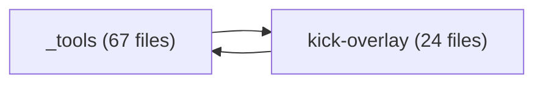

# Macro Feature Architecture — kicktwitchyoutube_instagram

> Auto-synced from Git (`178e1ef`) at `2026-11-27T15:33:33Z` by `feature_map_sync.py`.
> Refine `how_it_works`, `inputs`, `outputs`, `interlinks`, `verify_cmd`, and `metric_ids` in `features/features.json` (set `"curated": true`) — re-syncs preserve curated contracts while keeping file lists & commits live.

## 1. Macro Feature Matrix

| Feature | Files | Commits | Inputs | Outputs | Interlinks | How It Works |
|---|---:|---:|---|---|---|---|
| `_tools` | 67 | 180 | the repository working tree and its git history; the extension's ring dump (`chrome.storage.local['ko.adlog']`) read over CDP; a guest Chrome on port 9446 with the unpacked extension loaded, or the owner's Chrome on 9222 for read-only probes | a gate verdict + receipt (`_evidence/ko-verify-latest.md`); machine artifacts per verified bug (`_evidence/<bug>-arms.md`) and reachability records; verdict lines on stdout (`RESULT PASS|FAIL ... checks=N failed=0`) that a lane quotes as evidence | kick-overlay | Instruments, never product: (1) `ko-verify.mjs` runs every static suite plus the ledger, census, artifact and revival gates and writes `_evi |
| `kick-overlay` | 24 | 308 | the Twitch watch page DOM: `[data-a-target="video-player"]`, the squeezeback/slate ad text, the page's own `HTMLVideoElement`; Twitch's HLS playlists as fetched by the page's own player worker (token, `adExtinf`, `#EXT-X-DATERANGE`) and the GQL usher (`playbackAccessToken`); real user gestures: pointer/key input on the page, the overlay bar, the popup (each carries an author stamp) | the overlay iframe + bar (`#ko-wrap`, `#ko-g1`, seek bar) with the kick/YouTube picture; published attributes the instruments read: `data-ko-owner`, `data-ko-audio-m/-v/-vis/-wt/-it`, `data-ko-adpark`, `data-ko-adblock`; media-element writes: pause/resume, `currentTime` seeks, `muted`/`volume`, `playbackRate` | _tools | Three worlds, one page. The ISOLATED content script (`content.js`) mounts the kick/YouTube layer in an iframe (`player.html`), arbitrates ow |

## 2. Subsystem Interconnection Graph

## 3. Per-Feature Contracts

### `_tools` —  Tools
- **How it works:** Instruments, never product: (1) `ko-verify.mjs` runs every static suite plus the ledger, census, artifact and revival gates and writes `_evidence/ko-verify-latest.md`; (2) `ko-census.mjs` parses the three product scripts and refuses growth of decisions that return with no log row; (3) `ko-adlog-verdict.mjs` / `ko-adlog-window.mjs` read the extension's own ring (`ko.adlog`) and print per-page-load verdicts (ON SCREEN, FROZEN, JUMPS, SOUND, POD FREEZE, DISPLAY, REPEATS, HOLD EXPIRY, RELOADS, BUILDS IN THIS RING); (4) `ko-snapshot.mjs` reads the attributes the page publishes without touching the tab; (5) `ko-harness.mjs` drives a guest Chrome (port 9446, marker `G:/Temp/ko-harness/guest.json`) for kickparity/muteauthor/parity; (6) `ko-replica/` is an offline, deterministic Twitch watch page + ad delivery (HTTPS with a self-signed cert, HLS playlists served with a sliding ad window, a player worker, the real ad DOM shapes) so a pod can be replayed without a live stream; (7) `ko-load-check.mjs` is the pre-flight ceiling reading; (8) `ko-real-capture.mjs` + `ko-replica/compare.mjs` diff a real capture against the replica.
- **Inputs:** the repository working tree and its git history, the extension's ring dump (`chrome.storage.local['ko.adlog']`) read over CDP, a guest Chrome on port 9446 with the unpacked extension loaded, or the owner's Chrome on 9222 for read-only probes, replica scenarios (`_tools/ko-replica/scenarios/*.json`) plus generated media under `G:/Temp/ko-replica/media`
- **Outputs:** a gate verdict + receipt (`_evidence/ko-verify-latest.md`), machine artifacts per verified bug (`_evidence/<bug>-arms.md`) and reachability records, verdict lines on stdout (`RESULT PASS|FAIL ... checks=N failed=0`) that a lane quotes as evidence, replica run directories under `G:/Temp/ko-replica/runs/<scenario>-<ms>/`
- **Interlinks:** kick-overlay
- **Verify command:** `node _tools/ko-census.mjs --gate`
- **Metric budgets:** basic.census_ms, e2e.gate_wall_ms
- **Key files (67):** `_tools/cdp-daemon.mjs`, `_tools/cdp.mjs`, `_tools/gate/adlog-verdict-selftest.mjs`, `_tools/gate/arms.mjs`, `_tools/gate/checks/artifacts.mjs`, `_tools/gate/checks/index.mjs`, `_tools/gate/checks/instruments.mjs`, `_tools/gate/checks/ledger.mjs`, `_tools/gate/checks/revival.mjs`, `_tools/gate/checks/static-contracts.mjs`, `_tools/gate/checks/suites.mjs`, `_tools/gate/checks/syntax.mjs` ...

### `kick-overlay` — Kick Overlay
- **How it works:** Three worlds, one page. The ISOLATED content script (`content.js`) mounts the kick/YouTube layer in an iframe (`player.html`), arbitrates ownership of the screen (`data-ko-owner`, `overlayOwnsPicture`, `OWNER_GRACE_MS`), pauses/resumes the page's own `<video>` through the stall watchdog (`nativeStallWatch`, which refuses with a named row), publishes the display clock verdicts (LIVE/BEHIND/REPEAT/FROZEN/PAUSED), sets the toolbar badge (`setBadge` -> `chrome.action`) and heals a stale tab only while it is hidden. `ko-audio.js` is the single writer of mute/volume (intent x policy x visible surface), persisted per tab in sessionStorage. The MAIN-world ad path (`twitch-adblock.js`) detects an ad by paint + slate text + the worker-hooked playlist, opens a pod, mints a clean source over Twitch's GQL usher, covers the native with the clean picture only once it is decoding at the sync target (`cleanLatTarget`, reveal waits for the caught-up report), freezes the page element for the pod's duration, and hands back exactly once (timeline-reset detection, buffered-edge or wall-clock target, `handback-wait` until `rs >= 3` or 3 s). `adblock-bridge.js` crosses the world boundary in both directions; `background.js` installs the DNR rules and the packaged resources (it holds no storage record and no badge).
- **Inputs:** the Twitch watch page DOM: `[data-a-target="video-player"]`, the squeezeback/slate ad text, the page's own `HTMLVideoElement`, Twitch's HLS playlists as fetched by the page's own player worker (token, `adExtinf`, `#EXT-X-DATERANGE`) and the GQL usher (`playbackAccessToken`), real user gestures: pointer/key input on the page, the overlay bar, the popup (each carries an author stamp), `chrome.storage.local` records (`ko.v2`), per-tab `sessionStorage` (`ko.audio.v2`), and the server-space preference
- **Outputs:** the overlay iframe + bar (`#ko-wrap`, `#ko-g1`, seek bar) with the kick/YouTube picture, published attributes the instruments read: `data-ko-owner`, `data-ko-audio-m/-v/-vis/-wt/-it`, `data-ko-adpark`, `data-ko-adblock`, media-element writes: pause/resume, `currentTime` seeks, `muted`/`volume`, `playbackRate`, the ring: transition-only rows in `chrome.storage.local['ko.adlog']` (`overlay-reveal`, `native-handoff`, `handback-wait`, `ad-ui-hold`, `standby-level`, `audio-intent`, `display-*`, ...)
- **Interlinks:** _tools
- **Verify command:** `node _tools/ko-verify.mjs`
- **Metric budgets:** basic.syntax_check_ms, subsystem.bridge_handshake_ms, subsystem.mute_decision_ms, subsystem.ad_time_continuity_ms
- **Key files (24):** `kick-overlay/ad-detect-test.cjs`, `kick-overlay/ad-time-continuity-test.cjs`, `kick-overlay/adblock-bridge.js`, `kick-overlay/audio-authority-test.cjs`, `kick-overlay/background.js`, `kick-overlay/bridge-handshake-test.cjs`, `kick-overlay/channel-switch-test.cjs`, `kick-overlay/cold-cover-fixture-test.cjs`, `kick-overlay/content-fix-test.cjs`, `kick-overlay/content.js`, `kick-overlay/hls/hls.min.js`, `kick-overlay/ivs/amazon-ivs-wasmworker.min.js` ...

## 4. Self-Improvement Memory (Auto-Projected from `revival/sim.jsonl`)

> **Single source of truth:** Never hand-edit this section — record via `sim_memory.py predict` / `observe` into `revival/sim.jsonl` and re-sync. That recorder is NOT a file in this repo: it lives in the shared skills tree (`C:/Users/Administrador/.agents/skills/project-revival/scripts/sim_memory.py`), untracked here, and the pre-commit hook names that absolute path.

| Root Cause ID | Hypothesis | Attempts (Pass/Fail) | Latest Rationale & Observed Outcome | Provenance |
|---|---|---:|---|---|
| `unbounded-hang-risk` | 65 fetch/spawn/while(true) sites in this tree have no bound, so a wedged Chrome, browser or CDP endpoint hangs | 1P / 0F | **A hang is a defect of the launch, not a slow result: every wait must refuse at its own dea** -> files_scanned=103, total_findings 65 -> 0, verdict PASS, rc 0, wall 166.5 ms | `deepseek-v4.1-flash` / `fail_fast_audit.py scan --repo . --gate --all-code` |
| `suite-real-clock-sleeps` | content-fix-test.cjs spent 8.16 s of 9.65 s IDLE on real timers, so the per-edit loop could not fit in seconds | 1P / 1F | **Attempted one-pass conversion.** -> FAILED: run ended after arm A with rc 0 (1 of 52 arms) - an unsettled await read as a pass; fixed by real-cloc | `deepseek-v4.1-flash` / `node content-fix-test.cjs` |
  - _Failed attempt r2_ (`suite-real-clock-sleeps`): First shipped shape: only content.js timers virtual, stub callbacks virtual, single drain  -> **FAIL**: FAILED: run ended after arm A with rc 0 (1 of 52 arms) - an unsettled await read as a pass; fixed by real-cloc
| `no-impacted-fast-loop` | The per-edit loop ran the two heaviest suites unconditionally (11.1 s), so an edit anywhere paid 11 s or the a | 1P / 0F | **Landing runs everything once; the edit loop runs only what the edit can break.** -> twitch-adblock.js suites=3 wall=1880 ms PASS; content.js suites=1 wall=1218 ms PASS; 37-file diff refuted rc 2 | `deepseek-v4.1-flash` / `node _tools/gate/fast-loop.mjs --files <file>` |
| `slider-instrument-unreachable` | observability scored named/all-return-statements (75/654): 579 of those exits are pure value getters (return n | 1P / 0F | **A slider must be able to fail: the old observability formula cannot exceed 27 even if ever** -> observability 11 -> 45 as a four-fact composite (refusals 0/105 guards carry a row; state 38/68 fields referen | `deepseek-v4.1-flash` / `node harness/twins/slider_probe.mjs --all --json` |
| `extension-fetch-unbounded` | kick.com probes in content.js (kickPlaybackUrl, kickFetchDvr) and popup.js (kickStatus) had no AbortSignal, so | 1P / 0F | **A refusal at a deadline is the same law the tooling sweep applied, and a popup that waits ** -> content-fix: ALL CONTENT.JS FIX CHECKS PASSED, ARMS 52/52 present, KO_VER 0.8.129 unchanged; node --check clea | `deepseek-v4.1-flash` / `node _tools/gate/fast-loop.mjs --files kick-overlay/content.js` |
| `observability-denominator-and-silent-guards` | the census could not see a row written by a refusal helper, the refusals fact divided by its own numerator, an | 1P / 0F | **a refusal that writes no row is the class every wave paid for, and the metric must fall wh** -> census guardShaped 105->4 of baseline 113 (refusals 96.5), state 38->44 of 68 referenced (64.7), 12/12 suites  | `slider_probe` / `observability` |
| `generated-map-drift` | A generated feature map (features/features.json, features/INDEX.md) goes stale the moment a new tool file land | 4P / 0F | **The rail rewrites this file every run; leaving it dirty makes the next commit carry an une** -> revival/FRICTION.json carries the acceptance runs' timings only (9/9 lines), gate PASS problems [] on the comm | `deepseek-v4.1-flash` / `feature_map_sync.py --gate` |
| `slider-record-without-evidence` | A recorded slider score goes stale or is written from a remembered number, so the record must be regenerated b | 1P / 0F | **The scorecard's numbers are claims; the record must carry the command that produced them a** -> slider_scorecard.py report --repo . --strict-evidence -> overall_0_100 94.1, sliders_below_target 1 (delivery_ | `opencode-go/hy4-flash-free` / `slider_probe` |
| `one-evidence-blob-not-eight-proofs` | A slider row's number is a claim; recording eight rows with one shared evidence paragraph makes the file read  | 1P / 0F | **The scorecard's duplicate_evidence arm exists because the live file already did this once;** -> slider_scorecard.py report --strict-evidence -> duplicate_evidence [], unmeasured_sliders [], gaps [('delivery | `opencode-go/hy4-flash-free` / `slider_scorecard` |
| `rulebook-carries-history` | AGENTS.md accumulated 2790 lines of wave narrative beside its rules, so the delivery_balance hygiene sub-score | 1P / 0F | **The sub-score asks one question: is history somewhere other than the rulebook? An archive ** -> landing_ratio_check --balance-score: score_0_100 100, band Product-Led, subs product 40/40 telemetry 25/25 hyg | `deepseek-v4.1-flash` / `landing_ratio_check --balance-score; feature_map_sync --gate` |
| `timing-metric-grades-a-queue` | A wall-clock metric whose command is the suite itself cannot tell a slow product from a busy box, so the accep | 1P / 0F | **benchmark_history already turns a typed latency_refused into CANNOT-MEASURE; the missing p** -> wrapper arms 14/14 PASS (busy refuses with total/busiest/pinned, cannot refuses naming the missing reading, re | `deepseek-v4.1-flash` / `revival_verify.py --repo . ; node _tools/ko-verify.mjs` |
| `guest-start-ignores-preflight` | The load pre-flight is advisory: ko-load-check printed BUSY and ko-guest.mjs started an 18-process guest anywa | 1P / 0F | **Advice in a log is not a limit; the artifact that starts the heavy step must be the one th** -> selftest 12/12 PASS arms=4/4; real busy arm 'guest not started: BUSY total=100% busiest=100% pinned=20' rc=3 w | `deepseek-v4.1-flash` / `node _tools/ko-verify.mjs; node _tools/gate/guest-load-guard-selftest.mjs` |
| `ad-worker-hook-can-vanish` | The ad path can only see playlists through the page's player worker; a live episode measured worker-hooked=NON | 1P / 1F | **The honest fix belongs where the blindness was: the reader had the fact and did not use it** -> selftest 8/8 PASS arms=4/4; RED mutant -> RESULT FAIL adlog-verdict checks=8 failed=3; gate RESULT PASS checks | `deepseek-v4.1-flash` / `node _tools/ko-verify.mjs` |
  - _Failed attempt r1_ (`ad-worker-hook-can-vanish`): Record KO-20261127-06 with the four episodes; the arm that makes it structural (an episode -> **FAIL**: KO-20261127-06 recorded (episodes=4, worker_hooked=[worker+worker x3, NONE], worker_playlist=2). NO arm yet: a
| `verdict-names-numbers-not-the-ceiling` | The load verdict returned total/busiest/pinned and both ceilings but never named WHICH ceiling broke, so a ref | 1P / 0F | **A refusal whose message invites a wrong reading is a defect in the refusal: the reader had** -> breach+why present; load-check-json 55/55 PASS; guest-load-guard 14/14 PASS; RED mutant (breach hardcoded 'tot | `deepseek-v4.1-flash` / `node _tools/gate/load-check-test.mjs; node _tools/gate/guest-load-guard-selftest.mjs` |
| `arm-verdict-depends-on-box-load` | A pre-fix arm asserted a tick count inside a fixed window, so the same tree produced FAIL inside a gate run at | 1P / 1F | **An arm whose verdict moves with the box's spare CPU is measuring the queue; the twin exist** -> RESULT PASS cold-cover-fixture checks=20 failed=0 x3; RED (real-clock read) FAIL checks=20 failed=2; gate RESU | `deepseek-v4.1-flash` / `node kick-overlay/cold-cover-fixture-test.cjs` |
  - _Failed attempt r1_ (`arm-verdict-depends-on-box-load`): KO-20261127-07 records both gate runs, the three clean solo runs and the load; the arm fix -> **FAIL**: KO-20261127-07 recorded with both gate runs and 3/3 solo PASS; NO arm written yet - the pre-fix arm still asse
| `repo-scoped-search-cannot-clear-shared-tree` | Every instrument this project runs (recorder, map sync, blast-radius, sliders) lives in the shared skills tree | 1P / 0F | **The lane that depends on eight external scripts has to say where they live, or each round ** -> AGENTS.md rule added (4 lines) beside the recorder note; gate RESULT PASS checks=36 failed=0; nothing executab | `deepseek-v4.1-flash` / `node _tools/ko-verify.mjs` |
| `silent-refusal-hides-the-transport` | A refusal written as a bare return makes 'no ad was served' and 'the page's own playlist was rejected' the sam | 1P / 0F | **Put the decision where the refusal is, and name the loader that carries the stream, so the** -> ko-verify RESULT PASS checks=36 failed=0 (ad-time-continuity 198 checks, ad-detect ARMS 117/117, both RED arms | `opencode-go-4/deepseek-v4.1-flash` / `ad-time-continuity + ad-detect + ko-verify` |
| `ad-route-host-test-refuses-its-own-transport` | The live-media host test encodes the assumption that the page's stream comes from playlist.live-video.net, whi | 1P / 0F | **The next agent reading the ad path must not assume the route covers the page's stream, and** -> rule landed in AGENTS.md line beside the silent-census bullet; gate RESULT PASS checks=36 failed=0 after the e | `opencode-go-4/deepseek-v4.1-flash` / `ko-verify + bug-ledger` |
| `slider-rubric-reports-rewrite-tracked-state` | slider_scorecard.py report upgrades benchmarks/sliders.json to revival.sliders/v2 (per-slider levels + why_not | 1P / 0F | **A tool whose read path rewrites tracked state should converge, not repeat: landing the can** -> report run twice after the landing: git diff --stat benchmarks/sliders.json unchanged at 74 insertions/10 dele | `opencode-go-4/deepseek-v4.1-flash` / `slider_scorecard report --strict-evidence` |
| `ad-decision-and-ad-action-read-different-evidence` | playlistInfo() decided adOnly from the ,live suffix alone while stripAds() refused to act without Twitch's mar | 1P / 0F | **The function that ACTS holds the evidence; the function that DECIDES must read it. Keying ** -> RESULT PASS ad-detect ARMS 119/119; RESULT PASS cold-cover-fixture checks=20 failed=0; RESULT PASS ad-time-con | `opencode-go-4/deepseek-v4.1-flash` / `node ad-detect-test.cjs && node cold-cover-fixture-test.cjs && node ad-time-continuity-test.cjs` |
| `harness-matrix-two-direction-rewrite` | a matrix row whose adverse cell is prose cannot be a falsifier: the reader runs the cell as a command, so the  | 1P / 0F | **the neg cells held prose; harness_run executed them with shell=True, got rc=127, and print** -> 15/15 PASS, ratio 1.0 on 5 derivations; sliders PASS 98.8; revival_verify PASS maturity 100.0 hard 7/7 | `deepseek-v4.1-flash (omp seat)` / `harness_run.py --project . --json + slider_scorecard.py report --strict-evidence` |
