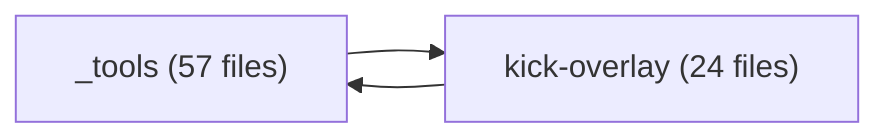

# Macro Feature Architecture — kicktwitchyoutube_instagram

> Auto-synced from Git (`56386f7`) at `2026-11-27T06:50:17Z` by `feature_map_sync.py`.
> Refine `how_it_works`, `inputs`, `outputs`, `interlinks`, `verify_cmd`, and `metric_ids` in `features/features.json` (set `"curated": true`) — re-syncs preserve curated contracts while keeping file lists & commits live.

## 1. Macro Feature Matrix

| Feature | Files | Commits | Inputs | Outputs | Interlinks | How It Works |
|---|---:|---:|---|---|---|---|
| `_tools` | 57 | 128 | the repository working tree and its git history; the extension's ring dump (`chrome.storage.local['ko.adlog']`) read over CDP; a guest Chrome on port 9446 with the unpacked extension loaded, or the owner's Chrome on 9222 for read-only probes | a gate verdict + receipt (`_evidence/ko-verify-latest.md`); machine artifacts per verified bug (`_evidence/<bug>-arms.md`) and reachability records; verdict lines on stdout (`RESULT PASS|FAIL ... checks=N failed=0`) that a lane quotes as evidence | kick-overlay | Instruments, never product: (1) `ko-verify.mjs` runs every static suite plus the ledger, census, artifact and revival gates and writes `_evi |
| `kick-overlay` | 24 | 293 | the Twitch watch page DOM: `[data-a-target="video-player"]`, the squeezeback/slate ad text, the page's own `HTMLVideoElement`; Twitch's HLS playlists as fetched by the page's own player worker (token, `adExtinf`, `#EXT-X-DATERANGE`) and the GQL usher (`playbackAccessToken`); real user gestures: pointer/key input on the page, the overlay bar, the popup (each carries an author stamp) | the overlay iframe + bar (`#ko-wrap`, `#ko-g1`, seek bar) with the kick/YouTube picture; published attributes the instruments read: `data-ko-owner`, `data-ko-audio-m/-v/-vis/-wt/-it`, `data-ko-adpark`, `data-ko-adblock`; media-element writes: pause/resume, `currentTime` seeks, `muted`/`volume`, `playbackRate` | _tools | Three worlds, one page. The ISOLATED content script (`content.js`) mounts the kick/YouTube layer in an iframe (`player.html`), arbitrates ow |

## 2. Subsystem Interconnection Graph

## 3. Per-Feature Contracts

### `_tools` —  Tools
- **How it works:** Instruments, never product: (1) `ko-verify.mjs` runs every static suite plus the ledger, census, artifact and revival gates and writes `_evidence/ko-verify-latest.md`; (2) `ko-census.mjs` parses the three product scripts and refuses growth of decisions that return with no log row; (3) `ko-adlog-verdict.mjs` / `ko-adlog-window.mjs` read the extension's own ring (`ko.adlog`) and print per-page-load verdicts (ON SCREEN, FROZEN, JUMPS, SOUND, POD FREEZE, DISPLAY, REPEATS, HOLD EXPIRY, RELOADS, BUILDS IN THIS RING); (4) `ko-snapshot.mjs` reads the attributes the page publishes without touching the tab; (5) `ko-harness.mjs` drives a guest Chrome (port 9446, marker `G:/Temp/ko-harness/guest.json`) for kickparity/muteauthor/parity; (6) `ko-replica/` is an offline, deterministic Twitch watch page + ad delivery (HTTPS with a self-signed cert, HLS playlists served with a sliding ad window, a player worker, the real ad DOM shapes) so a pod can be replayed without a live stream; (7) `ko-load-check.mjs` is the pre-flight ceiling reading; (8) `ko-real-capture.mjs` + `ko-replica/compare.mjs` diff a real capture against the replica.
- **Inputs:** the repository working tree and its git history, the extension's ring dump (`chrome.storage.local['ko.adlog']`) read over CDP, a guest Chrome on port 9446 with the unpacked extension loaded, or the owner's Chrome on 9222 for read-only probes, replica scenarios (`_tools/ko-replica/scenarios/*.json`) plus generated media under `G:/Temp/ko-replica/media`
- **Outputs:** a gate verdict + receipt (`_evidence/ko-verify-latest.md`), machine artifacts per verified bug (`_evidence/<bug>-arms.md`) and reachability records, verdict lines on stdout (`RESULT PASS|FAIL ... checks=N failed=0`) that a lane quotes as evidence, replica run directories under `G:/Temp/ko-replica/runs/<scenario>-<ms>/`
- **Interlinks:** kick-overlay
- **Verify command:** `node _tools/ko-census.mjs --gate`
- **Metric budgets:** basic.census_ms, e2e.gate_wall_ms
- **Key files (57):** `_tools/cdp-daemon.mjs`, `_tools/cdp.mjs`, `_tools/gate/arms.mjs`, `_tools/gate/checks/artifacts.mjs`, `_tools/gate/checks/index.mjs`, `_tools/gate/checks/instruments.mjs`, `_tools/gate/checks/ledger.mjs`, `_tools/gate/checks/revival.mjs`, `_tools/gate/checks/static-contracts.mjs`, `_tools/gate/checks/suites.mjs`, `_tools/gate/checks/syntax.mjs`, `_tools/gate/checks/tooling.mjs` ...

### `kick-overlay` — Kick Overlay
- **How it works:** Three worlds, one page. The ISOLATED content script (`content.js`) mounts the kick/YouTube layer in an iframe (`player.html`), arbitrates ownership of the screen (`data-ko-owner`, `overlayOwnsPicture`, `OWNER_GRACE_MS`), pauses/resumes the page's own `<video>` through the stall watchdog (`nativeStallWatch`, which refuses with a named row), publishes the display clock verdicts (LIVE/BEHIND/REPEAT/FROZEN/PAUSED), sets the toolbar badge (`setBadge` -> `chrome.action`) and heals a stale tab only while it is hidden. `ko-audio.js` is the single writer of mute/volume (intent x policy x visible surface), persisted per tab in sessionStorage. The MAIN-world ad path (`twitch-adblock.js`) detects an ad by paint + slate text + the worker-hooked playlist, opens a pod, mints a clean source over Twitch's GQL usher, covers the native with the clean picture only once it is decoding at the sync target (`cleanLatTarget`, reveal waits for the caught-up report), freezes the page element for the pod's duration, and hands back exactly once (timeline-reset detection, buffered-edge or wall-clock target, `handback-wait` until `rs >= 3` or 3 s). `adblock-bridge.js` crosses the world boundary in both directions; `background.js` installs the DNR rules and the packaged resources (it holds no storage record and no badge).
- **Inputs:** the Twitch watch page DOM: `[data-a-target="video-player"]`, the squeezeback/slate ad text, the page's own `HTMLVideoElement`, Twitch's HLS playlists as fetched by the page's own player worker (token, `adExtinf`, `#EXT-X-DATERANGE`) and the GQL usher (`playbackAccessToken`), real user gestures: pointer/key input on the page, the overlay bar, the popup (each carries an author stamp), `chrome.storage.local` records (`ko.v2`), per-tab `sessionStorage` (`ko.audio.v2`), and the server-space preference
- **Outputs:** the overlay iframe + bar (`#ko-wrap`, `#ko-g1`, seek bar) with the kick/YouTube picture, published attributes the instruments read: `data-ko-owner`, `data-ko-audio-m/-v/-vis/-wt/-it`, `data-ko-adpark`, `data-ko-adblock`, media-element writes: pause/resume, `currentTime` seeks, `muted`/`volume`, `playbackRate`, the ring: transition-only rows in `chrome.storage.local['ko.adlog']` (`overlay-reveal`, `native-handoff`, `handback-wait`, `ad-ui-hold`, `standby-level`, `audio-intent`, `display-*`, ...)
- **Interlinks:** _tools
- **Verify command:** `node _tools/ko-verify.mjs`
- **Metric budgets:** basic.syntax_check_ms, subsystem.bridge_handshake_ms, subsystem.mute_decision_ms, subsystem.ad_time_continuity_ms
- **Key files (24):** `kick-overlay/ad-detect-test.cjs`, `kick-overlay/ad-time-continuity-test.cjs`, `kick-overlay/adblock-bridge.js`, `kick-overlay/audio-authority-test.cjs`, `kick-overlay/background.js`, `kick-overlay/bridge-handshake-test.cjs`, `kick-overlay/channel-switch-test.cjs`, `kick-overlay/cold-cover-fixture-test.cjs`, `kick-overlay/content-fix-test.cjs`, `kick-overlay/content.js`, `kick-overlay/hls/hls.min.js`, `kick-overlay/ivs/amazon-ivs-wasmworker.min.js` ...

## 4. Self-Improvement Memory (Auto-Projected from `revival/sim.jsonl`)

> **Single source of truth:** Never hand-edit this section — record via `sim_memory.py predict` / `observe` in `revival/sim.jsonl` and re-sync.

| Root Cause ID | Hypothesis | Attempts (Pass/Fail) | Latest Rationale & Observed Outcome | Provenance |
|---|---|---:|---|---|
| `unbounded-hang-risk` | 65 fetch/spawn/while(true) sites in this tree have no bound, so a wedged Chrome, browser or CDP endpoint hangs | 1P / 0F | **A hang is a defect of the launch, not a slow result: every wait must refuse at its own dea** -> files_scanned=103, total_findings 65 -> 0, verdict PASS, rc 0, wall 166.5 ms | `deepseek-v4.1-flash` / `fail_fast_audit.py scan --repo . --gate --all-code` |
| `suite-real-clock-sleeps` | content-fix-test.cjs spent 8.16 s of 9.65 s IDLE on real timers, so the per-edit loop could not fit in seconds | 1P / 1F | **Attempted one-pass conversion.** -> FAILED: run ended after arm A with rc 0 (1 of 52 arms) - an unsettled await read as a pass; fixed by real-cloc | `deepseek-v4.1-flash` / `node content-fix-test.cjs` |
  - _Failed attempt r2_ (`suite-real-clock-sleeps`): First shipped shape: only content.js timers virtual, stub callbacks virtual, single drain  -> **FAIL**: FAILED: run ended after arm A with rc 0 (1 of 52 arms) - an unsettled await read as a pass; fixed by real-cloc
| `no-impacted-fast-loop` | The per-edit loop ran the two heaviest suites unconditionally (11.1 s), so an edit anywhere paid 11 s or the a | 1P / 0F | **Landing runs everything once; the edit loop runs only what the edit can break.** -> twitch-adblock.js suites=3 wall=1880 ms PASS; content.js suites=1 wall=1218 ms PASS; 37-file diff refuted rc 2 | `deepseek-v4.1-flash` / `node _tools/gate/fast-loop.mjs --files <file>` |
