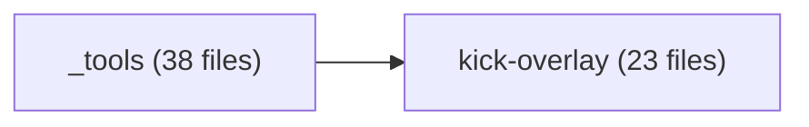

# Macro Feature Architecture — kicktwitchyoutube_instagram

> Auto-synced from Git (`b05576f`) at `2026-11-26T19:53:04Z` by `feature_map_sync.py`.
> Refine `how_it_works`, `inputs`, `outputs`, `interlinks`, `verify_cmd`, and `metric_ids` in `features/features.json` (set `"curated": true`) — re-syncs preserve curated contracts while keeping file lists & commits live.

## 1. Macro Feature Matrix

| Feature | Files | Commits | Inputs | Outputs | Interlinks | How It Works |
|---|---:|---:|---|---|---|---|
| `_tools` | 38 | 116 | CLI args / stdin; Environment variables / config; IPC / WebSocket events | IPC / UI state updates; Persisted files / DB state; Structured stdout / logs | kick-overlay | Macro subsystem owning 38 tracked code file(s) under `_tools`; recent evolution: fix(ad): end a playlist pod when the ad UI leaves, and stop |
| `kick-overlay` | 23 | 304 | CLI args / stdin; HTTP / API requests; IPC / WebSocket events | HTTP / JSON responses; IPC / UI state updates; Structured stdout / logs | - | Macro subsystem owning 23 tracked code file(s) under `kick-overlay`; recent evolution: 0.8.125: a rect of zero is not a small player, so the |

## 2. Subsystem Interconnection Graph

## 3. Per-Feature Contracts

### `_tools` —  Tools
- **How it works:** Macro subsystem owning 38 tracked code file(s) under `_tools`; recent evolution: fix(ad): end a playlist pod when the ad UI leaves, and stop starting the standby at 360p (0.8.111)
- **Inputs:** CLI args / stdin, Environment variables / config, IPC / WebSocket events
- **Outputs:** IPC / UI state updates, Persisted files / DB state, Structured stdout / logs
- **Interlinks:** kick-overlay
- **Verify command:** `UNSET — bind in features/features.json`
- **Metric budgets:** UNSET — bind in benchmarks/budgets.json
- **Key files (38):** `_tools/cdp-daemon.mjs`, `_tools/cdp.mjs`, `_tools/ko-adlog-verdict.mjs`, `_tools/ko-adlog-window.mjs`, `_tools/ko-auto-install.ps1`, `_tools/ko-cdp.mjs`, `_tools/ko-census.mjs`, `_tools/ko-click.mjs`, `_tools/ko-ctx.mjs`, `_tools/ko-eval.mjs`, `_tools/ko-gql-probe.mjs`, `_tools/ko-guest.mjs` ...

### `kick-overlay` — Kick Overlay
- **How it works:** Macro subsystem owning 23 tracked code file(s) under `kick-overlay`; recent evolution: 0.8.125: a rect of zero is not a small player, so the clean picture no longer opens at 360p
- **Inputs:** CLI args / stdin, HTTP / API requests, IPC / WebSocket events
- **Outputs:** HTTP / JSON responses, IPC / UI state updates, Structured stdout / logs
- **Interlinks:** none detected
- **Verify command:** `UNSET — bind in features/features.json`
- **Metric budgets:** UNSET — bind in benchmarks/budgets.json
- **Key files (23):** `kick-overlay/ad-detect-test.cjs`, `kick-overlay/ad-time-continuity-test.cjs`, `kick-overlay/adblock-bridge.js`, `kick-overlay/background.js`, `kick-overlay/bridge-handshake-test.cjs`, `kick-overlay/channel-switch-test.cjs`, `kick-overlay/cold-cover-fixture-test.cjs`, `kick-overlay/content-fix-test.cjs`, `kick-overlay/content.js`, `kick-overlay/hls/hls.min.js`, `kick-overlay/ivs/amazon-ivs-wasmworker.min.js`, `kick-overlay/ivs/index.js` ...
